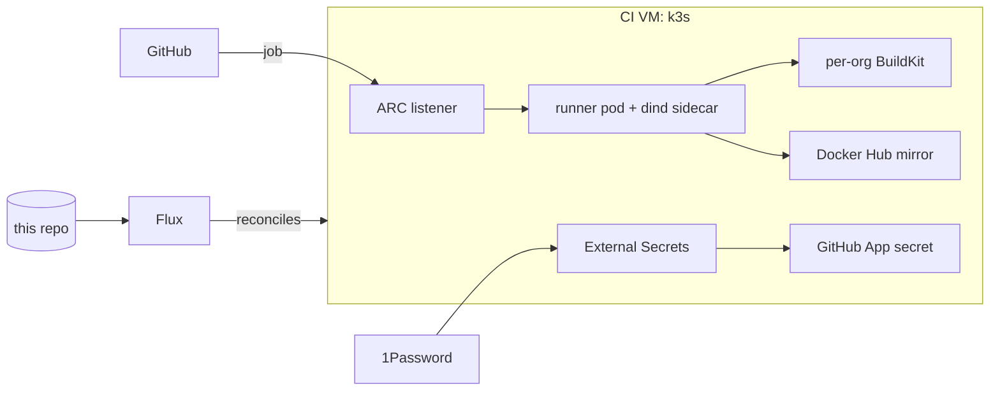

# Romulus: homelab server configuration

Configuration for a single homelab server (ZimaCube, Ryzen 9 5950X, 128 GB RAM, GTX 1650 SUPER, Ubuntu 26.04 LTS). This repo is the source of truth: Docker Compose stacks for the host, Flux manifests for a small CI cluster running in a VM on the same machine. Merging to `master` is deploying.

## Layout

| Path | What |
|------|------|
| `stacks/<stack>/` | Compose stacks, one single-line Dockerfile per service pinning its image |
| `stacks/host.env` | Non-secret host settings shared by all stacks |
| `configs/` | Service configs mounted read-only (Traefik, Authelia, Prometheus, Alertmanager, Grafana, Loki, ...) |
| `.doco-cd.yml` | Which stacks are deployed and which secrets each one gets |
| `host/doco-cd/` | The deployer itself |
| `scripts/` | Host setup, firewall, backups, snapshots, cron and systemd units |
| `clusters/`, `kubernetes/` | Flux and the CI runner cluster |
| `images/arc-runner/` | Runner image for the CI cluster |

## Stacks

| Stack | Services |
|-------|----------|
| **core** | Traefik, Docker socket proxy, Cloudflare DDNS, AdGuard Home, Tailscale |
| **security** | Authelia, CrowdSec, CrowdSec bouncer |
| **media** | Jellyfin, Sonarr, Radarr, Prowlarr, Bazarr, Lidarr, FlareSolverr, qBittorrent, Jellyseerr |
| **productivity** | Nextcloud, Immich, Home Assistant, Paperless-ngx, Actual Budget, Homebox, with their PostgreSQL and Redis |
| **monitoring** | Prometheus, Alertmanager, Grafana, Loki, Promtail, cAdvisor, node / GPU / SMART / restic exporters, Uptime Kuma, Glances |
| **notifications** | ntfy |
| **utilities** | Dozzle, Portainer, Speedtest, TeamSpeak, Watchtower (monitor only), Autoheal |
| **dashboard** | Homepage |
| **hydra** | Trading engine, dashboard and backtest worker ([hydra](https://github.com/somatczk/hydra)), TimescaleDB, Redis |

`stacks/ai` is kept but disabled.

## Deployment

Pull-based. [doco-cd](https://doco.cd) on the host polls `master` and deploys every stack listed in `.doco-cd.yml`; only services whose config changed are recreated. CI never touches the host.

- **Secrets** live in 1Password, one item per stack. doco-cd reads them through a local 1Password Connect server (no API rate limits, a rotated secret lands on the next poll); host scripts use a read-only service account. Each stack gets only the secrets it lists, each container only the variables its service maps. Nothing secret is in git.
- **Host files:** the checkout on the host is reset to `origin/master` by a systemd timer, which also re-applies the crons and the deployer.
- **Notifications:** deploy results go to ntfy and Telegram. Prometheus alerts route through Alertmanager to Telegram, with ntfy as fallback.
- **Rollback:** `git revert` on `master`.
- **Rotating a secret:** change it in 1Password; the next deploy of that stack picks it up. `HYDRA_CREDENTIAL_KEY` is the exception, see below.
- **Hydra secrets:** the hydra stack reads `HYDRA_DB_PASSWORD`, `HYDRA_CREDENTIAL_KEY` and `HYDRA_API_TOKEN` from the hydra item. `HYDRA_CREDENTIAL_KEY` is a Fernet key that encrypts the exchange API keys hydra stores in its database. Exchange keys are entered in hydra's Settings page, never in 1Password or env. Replacing `HYDRA_CREDENTIAL_KEY` with a new value makes every stored exchange key undecryptable. Rotate it as a MultiFernet list: set it to `new,old` (the first key encrypts, all keys decrypt), re-save the exchange keys in Settings, then set it to `new`.
- **Hydra network and auth:** `hydra-engine` is not on `proxy`. Traefik reaches it over `hydra-edge`, an internal network (10.10.13.0/24) whose only members are Traefik (static 10.10.13.2) and the engine (static 10.10.13.3); Prometheus scrapes it over `monitoring`. The engine trusts Authelia's `Remote-User` header only from `10.10.13.2/32` (`HYDRA_API__TRUSTED_PROXY_CIDRS`), and services authenticate with `Authorization: Bearer $HYDRA_API_TOKEN` (hydra item in 1Password). `.github/tests/hydra-network.sh` fails CI if anything else joins `hydra-edge` or these settings drift. `HYDRA_API__CORS_ORIGINS` is a comma list (`https://trading.${DOMAIN}`); without it the browser's mutating calls and WebSocket upgrades are refused.
- **Hydra config, health and backups:** the engine image's `/app/config` is authoritative and only `${APPDATA}/hydra/config/strategies` is mounted (rw for the engine, which saves UI-built strategies; ro for the backtest worker). The engine accepts only `HYDRA_*` variables its config declares, so an unknown one stops startup. Docker probes `/livez`; `/readyz` (DB, schema at the Alembic head, feeds, supervised sessions) drives the `HydraNotReady` alert and is never a healthcheck, because autoheal would restart-loop the engine on a feed or DB blip. The first boot of a release runs Alembic migrations under an advisory lock. The nightly hydra dump is `pg_dump -Fc` (`hydra_<ts>.dump` plus a `.counts` row manifest), and the monthly restore test restores it into a throwaway TimescaleDB on the stack's pinned image and checks `alembic_version` and the row counts. `configs/prometheus/hydra-alert-rules.yml`, its promtool test and `configs/grafana/dashboards/hydra-trading.json` are byte copies of hydra main's `deploy/` (`.github/tests/hydra-sync.sh`).

Host setup is one idempotent script, `scripts/install-gitops.sh` (packages, Docker networks, checkout, deployer, crons). A fresh host needs its storage restored from backup, a 1Password service account token, and that script.

## Updates

- **Dependabot** bumps images, GitHub Actions and Kubernetes manifest images weekly, after a 7 day cooldown. Patch and minor bumps auto-merge on green CI; majors, 0.x and calendar-version minors and anything stateful (databases, Immich, Nextcloud, Paperless, Home Assistant) wait for review.
- **Renovate** covers what Dependabot can't read: Helm chart versions and Flux itself.
- **CI** runs on GitHub-hosted runners: compose and Dockerfile validation, a check that new images exist, a render of every stack with only its declared secrets, actionlint, zizmor, kubeconform and gitleaks. `master` only takes PRs with green checks.

## CI platform

Self-hosted GitHub Actions runners for a few organisations run in a single-node k3s cluster inside a KVM guest, autoscaling from zero with [Actions Runner Controller](https://github.com/actions/actions-runner-controller).

- **GitOps:** Flux syncs `clusters/romulus` and `kubernetes/` from `master`; only the bootstrap is applied by hand. The tenants (orgs, GitHub Apps, scale sets) live in a private repo that Flux reads with a read-only deploy key.
- **Identity:** one GitHub App per organisation, no PATs. Keys reach the cluster from 1Password through External Secrets.
- **Runners:** an ephemeral pod per job with a dind sidecar, per-org cache and BuildKit, a shared Docker Hub pull-through mirror.
- **Supply chain:** the runner image is built on GitHub-hosted runners with SBOM and provenance, cosign-signed, and deployed by digest.
- **Isolation:** the host firewall fences the VM off the LAN; NetworkPolicies keep each org namespace to itself, DNS, the mirror and the internet. dind is privileged, so all orgs on the cluster share one trust boundary: the VM is the wall between CI and the homelab, not between orgs.

Bootstrap: `scripts/ci-vm/create.sh` builds the VM, then a 1Password service account token goes into the cluster and `kubectl apply -k clusters/romulus` hands over to Flux.

## Security

- Reachable on the LAN and over Tailscale only. Admin services sit behind Authelia with 2FA.
- Default-deny firewall, including between Docker networks. Most service networks are internal; the CI VM is fenced off the LAN.
- CrowdSec in front of Traefik, TLS 1.3 only, HSTS everywhere.
- Containers reach the Docker API only through read-only socket proxies.

## Storage and backups

- NVMe for the OS and Docker, SSD (btrfs) for app data, HDD (btrfs) for media and backups.
- Nightly database dumps plus an encrypted restic backup of all app data except the live Postgres data directories (the dumps cover them; a running database's files are not a consistent copy). Retention: 7 daily, 4 weekly, 6 monthly, 1 yearly.
- btrfs snapshots: hourly on the SSD, daily on the HDD.
- Monthly automated restore test, weekly `restic check`, scheduled scrub and balance. A stale or failed backup alerts through Prometheus.

## GPU

The GTX 1650 SUPER (4 GB) is shared by Jellyfin (NVENC/NVDEC transcoding) and Immich machine learning. CI runners don't get the GPU.
