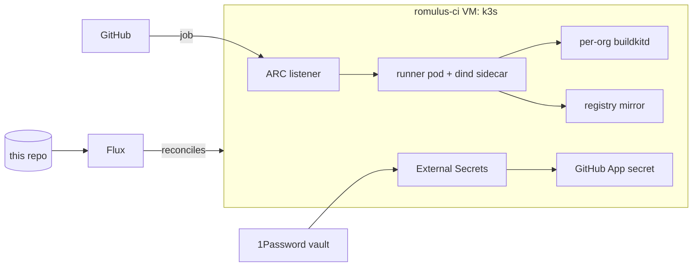

# Romulus: homelab server configuration

Homelab configuration for a ZimaCube (Ryzen 9 5950X, 128GB RAM, GTX 1650 SUPER) running Ubuntu 26.04 LTS. This repo is the source of truth: compose stacks for the host, Flux manifests for the CI cluster.

## Architecture

11 Docker Compose stacks:

| Stack | Services | RAM |
|-------|----------|-----|
| **core** | Traefik, Socket Proxy, Cloudflare DDNS, AdGuard | 960 MB |
| **security** | Authelia, CrowdSec, Bouncer | 640 MB |
| **media** | Jellyfin, Sonarr, Radarr, FlareSolverr, Prowlarr, Bazarr, Lidarr, qBittorrent, Jellyseerr | 11 GB |
| **productivity** | Nextcloud, Immich, Home Assistant, Paperless-ngx, Actual Budget, Homebox (+ PostgreSQL/Redis) | 26.5 GB |
| **monitoring** | Prometheus, Grafana, Loki, Promtail, Node/GPU/SMART/Restic Exporters, cAdvisor, Uptime Kuma, Glances | 5.1 GB |
| **ci** | hydra/romulus repo runners, Socket Proxy, BuildKit, registry mirror (org runners live in k3s, see CI platform) | ~30 GB |
| **notifications** | ntfy | 256 MB |
| **utilities** | Watchtower, Dozzle, Speedtest, Portainer, TeamSpeak, Autoheal | 2.6 GB |
| **dashboard** | Homepage | 512 MB |
| **ai** | Ollama, OpenClaw, Open WebUI, Socket Proxy | ~19 GB |
| **hydra** | Hydra Engine, Dashboard, Backtest Worker, TimescaleDB, Redis | 18.5 GB |

Image versions pinned in single-line Dockerfiles (`stacks/<stack>/<service>/Dockerfile`). Dependabot opens weekly PRs for bumps, auto-merged after CI passes.

## Deployment

```bash
cp stacks/.env.example stacks/.env  # fill in secrets
./deploy.sh                          # full deploy
./deploy.sh media ai verify          # selective
./deploy.sh --port 2222 verify       # after SSH hardening
```

On the server: `cd /DATA/stacks/stacks && docker compose --env-file .env -f <stack>/compose.yml up -d --build`

## CI platform

Organisation runners run in a single-node k3s cluster inside a KVM guest (`romulus-ci`, 24 vCPU, 96 GB RAM, 250 GB disk) and autoscale from zero with [Actions Runner Controller](https://github.com/actions/actions-runner-controller).



- **GitOps:** Flux syncs `clusters/romulus` and `kubernetes/` from `master`; nothing is applied by hand except the bootstrap below.
- **Identity:** one GitHub App per org (no PATs). Keys live in 1Password and reach the cluster through External Secrets; git holds no credentials, encrypted or not.
- **Runners:** ephemeral pods per job with a native dind sidecar. Labels match the old compose fleet, so workflows did not change. Per-org PVC cache, per-org BuildKit, shared Docker Hub mirror.
- **Supply chain:** the runner image (`images/arc-runner`) is built on GitHub-hosted runners with SBOM and provenance, cosign-signed from `master`, and deployed by digest.
- **Network:** the host fences the VM off the LAN (`scripts/hardening-firewall.sh`, `vm()`); NetworkPolicies keep each org namespace to itself, DNS, the mirror and the internet.

**Trust model.** dind needs `privileged`, so a job can reach the node. Every org on this cluster therefore shares one trust boundary; the VM is the wall between CI and the homelab, not between orgs. All orgs here belong to the same owner. A tenant needing hard isolation gets its own VM (`create.sh` with another name/IP).

**Capacity.** Requests (4 GiB heavy, 2 GiB light per pod) are what the scheduler packs; limits (16 GiB heavy, 7 GiB light) overcommit on purpose because jobs rarely peak together. Kubelet reserves 4 GiB for the system and evicts below 2 GiB free. Max concurrency: vetoo 4 heavy (1 warm) + 8 light, coordentra 1 + 2, solhouse 2.

**Bootstrap / disaster recovery** (caches are rebuildable and not backed up):

```bash
sudo scripts/ci-vm/create.sh ~/.ssh/id_ed25519.pub        # on romulus
ssh romulus-ci sudo cat /etc/rancher/k3s/k3s.yaml           # kubeconfig, server https://192.168.122.10:6443
kubectl create namespace external-secrets
op read "op://<vault>/<service account item>/credential" | tr -d '\n' | \
  kubectl -n external-secrets create secret generic onepassword-token --from-file=token=/dev/stdin
kubectl apply -k clusters/romulus/flux-system && kubectl apply -k clusters/romulus
```

Flux version: `flux install --export > clusters/romulus/flux-system/gotk-components.yaml` regenerates the vendored components (currently v2.9.6).

## Service URLs

All at `*.romulus.hu` via Traefik + Authelia 2FA:

| Service | URL |
|---------|-----|
| Homepage | `romulus.hu` |
| Traefik | `traefik.romulus.hu` |
| AdGuard | `dns.romulus.hu` |
| Authelia | `auth.romulus.hu` |
| Jellyfin | `jellyfin.romulus.hu` |
| Sonarr / Radarr / Prowlarr / Bazarr / Lidarr | `sonarr.` / `radarr.` / `prowlarr.` / `bazarr.` / `lidarr.romulus.hu` |
| qBittorrent | `qbit.romulus.hu` |
| Jellyseerr | `requests.romulus.hu` |
| Nextcloud | `cloud.romulus.hu` |
| Immich | `photos.romulus.hu` |
| Home Assistant | `home.romulus.hu` |
| Paperless-ngx | `paperless.romulus.hu` |
| Actual Budget | `budget.romulus.hu` |
| Homebox | `homebox.romulus.hu` |
| Grafana | `grafana.romulus.hu` |
| Uptime Kuma | `status.romulus.hu` |
| ntfy | `notify.romulus.hu` |
| Dozzle | `logs.romulus.hu` |
| Speedtest | `speed.romulus.hu` |
| Portainer | `portainer.romulus.hu` |
| TeamSpeak | `teamspeak.romulus.hu` |
| OpenClaw | `ai.romulus.hu` |
| Open WebUI | `chat.romulus.hu` |
| Hydra Trading | `trading.romulus.hu` |

## GPU Sharing

GTX 1650 SUPER (4GB VRAM) shared between:
- **Jellyfin**: NVENC/NVDEC transcoding (~200-500MB/stream)
- **Immich ML**: Face/object recognition (~1-2GB)
- **Ollama**: Hybrid CPU+GPU inference (~1-2GB, tunable via `OLLAMA_NUM_GPU`)

CI runners are CPU-only to prevent VRAM contention.

## Security

LAN + Tailscale only. SSH on port 2222 (key-only). Firewall defaults to DROP. Authelia 2FA on admin services. CrowdSec for threat intelligence. TLS 1.3 + HSTS everywhere. Docker socket proxied read-only. Backups AES-256 encrypted with restic.

## Backup

```bash
sudo /DATA/stacks/scripts/backup.sh           # run backup
restic -r /media/HDD-Storage/backups/restic-repo snapshots  # check
restic restore latest --target /tmp/restore    # restore
```

BTRFS snapshots managed by `scripts/btrfs-snapshot.sh`.
